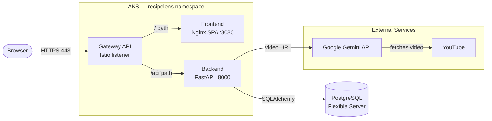
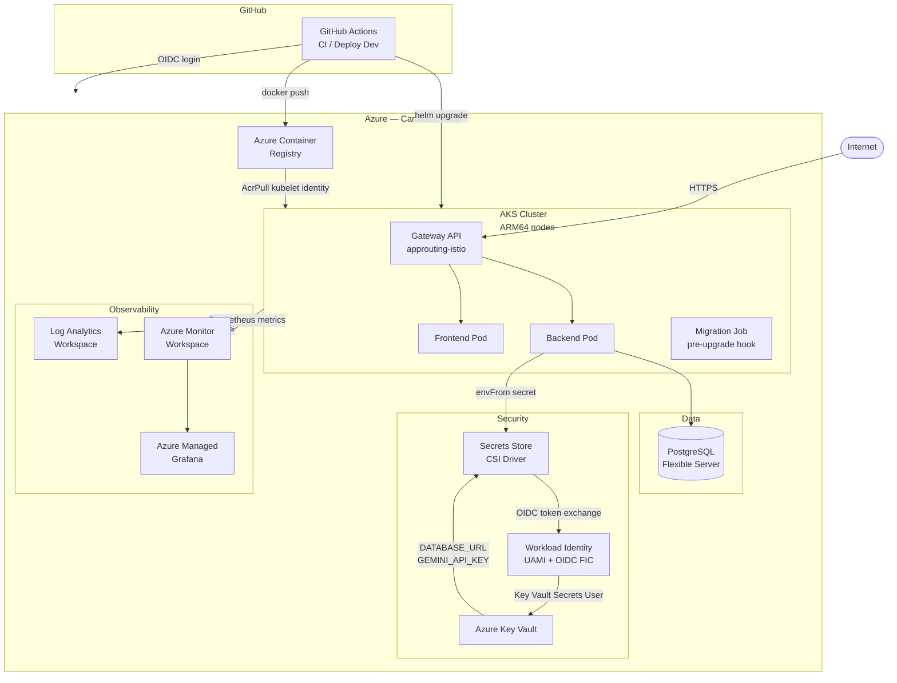
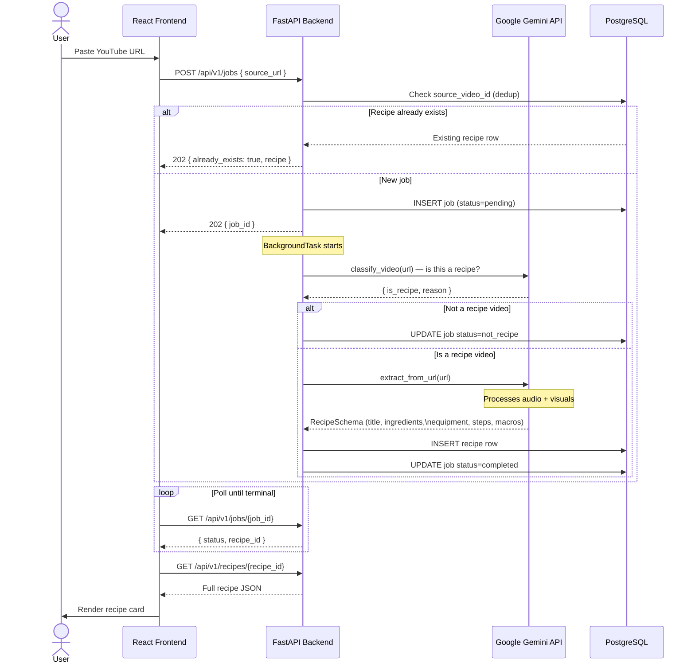
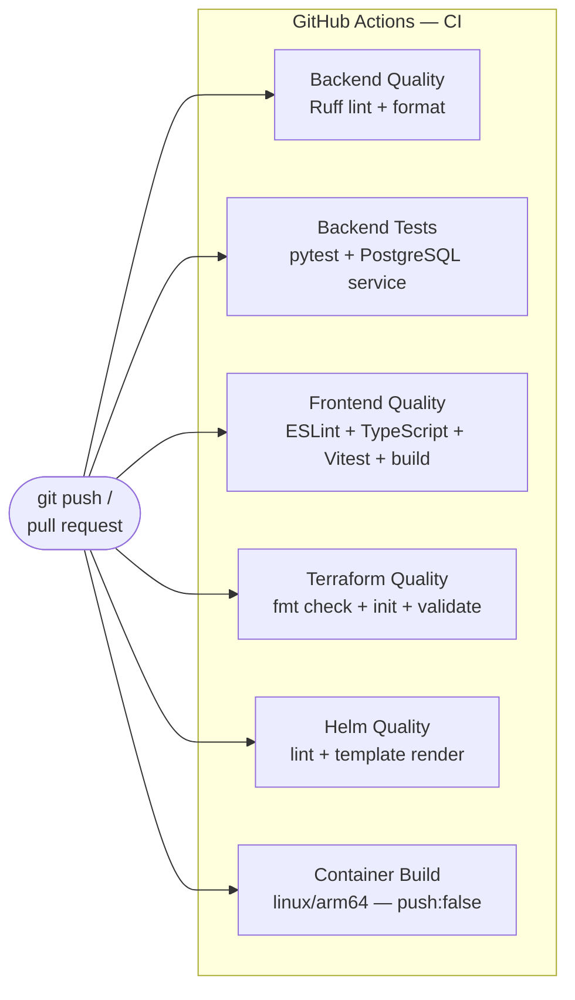
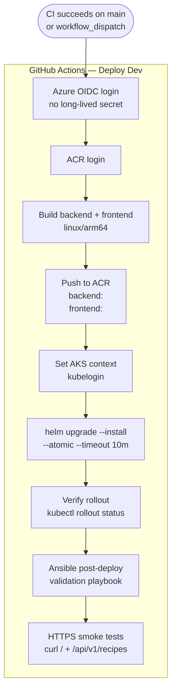
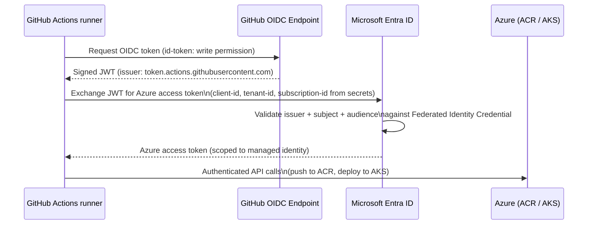
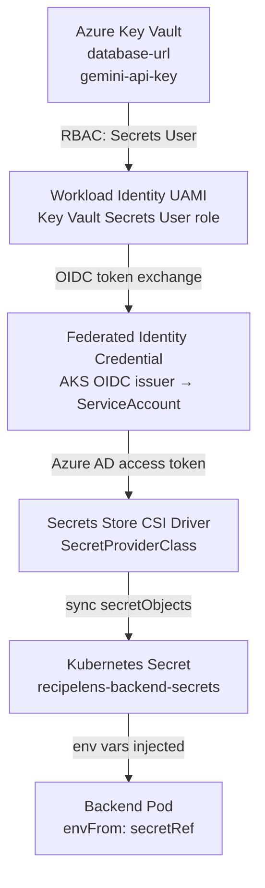
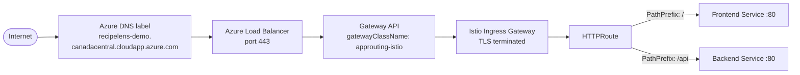
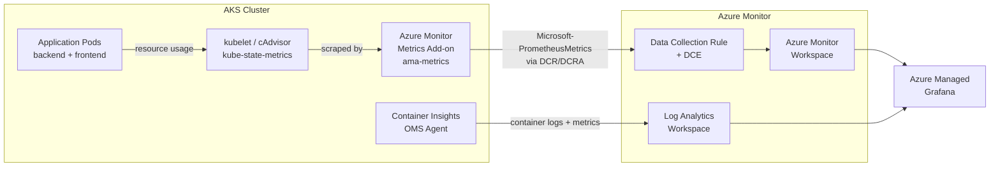
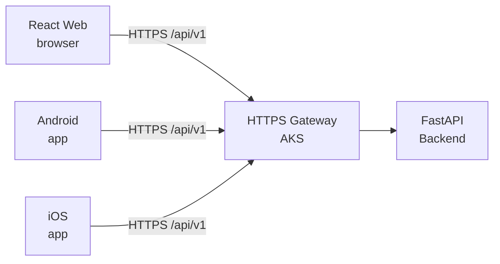

# RecipeLens

### Cloud-Native AI Recipe Extraction Platform on Azure

RecipeLens accepts a YouTube cooking video URL, sends it to Google's Gemini multimodal API for classification and structured recipe extraction, persists the result in PostgreSQL, and serves it through a React single-page application. The project demonstrates an end-to-end, production-style cloud delivery platform on Microsoft Azure — covering infrastructure as code, Kubernetes, secure secret management, CI/CD, and observability.

[](https://github.com/TheDeadSlayer/Recipe-Lens/actions/workflows/ci.yml)
[](https://github.com/TheDeadSlayer/Recipe-Lens/actions/workflows/deploy-dev.yml)


---

## Table of Contents

1. [Project Overview](#1-project-overview)
2. [Application Architecture](#2-application-architecture)
3. [Azure / Cloud Architecture](#3-azure--cloud-architecture)
4. [Request & Recipe Processing Flow](#4-request--recipe-processing-flow)
5. [Infrastructure as Code](#5-infrastructure-as-code)
6. [CI/CD Architecture](#6-cicd-architecture)
7. [GitHub OIDC / Passwordless Azure Authentication](#7-github-oidc--passwordless-azure-authentication)
8. [Kubernetes Deployment](#8-kubernetes-deployment)
9. [Secure Secret Management](#9-secure-secret-management)
10. [HTTPS / Networking](#10-https--networking)
11. [Observability](#11-observability)
12. [Ansible Post-Deployment Validation](#12-ansible-post-deployment-validation)
13. [Repository Structure](#13-repository-structure)
14. [Local Development](#14-local-development)
15. [Testing & Quality](#15-testing--quality)
16. [Deployment](#16-deployment)
17. [Operational Engineering](#17-operational-engineering)
18. [Scalability](#18-scalability)
19. [Potential Mobile Delivery Architecture](#19-potential-mobile-delivery-architecture)
20. [Technology Summary](#20-technology-summary)
21. [Future Improvements](#21-future-improvements)

---

## 1. Project Overview

A user pastes a YouTube cooking video URL into the RecipeLens frontend. The backend:

1. **Classifies** the video via Gemini — confirming it is a genuine recipe video before paying extraction cost.
2. **Extracts** structured recipe data: title, description, ingredients (name + quantity), equipment, ordered steps, and optional macronutrients (calories, protein, carbs, fat).
3. **Deduplicates** — if a recipe for the same video ID or identical content already exists, the cached result is returned immediately.
4. **Persists** the recipe in PostgreSQL.
5. **Serves** the recipe through a paginated REST API consumed by the React frontend.

```
YouTube URL  →  RecipeLens  →  Gemini (classify + extract)
                                      ↓
                               PostgreSQL  →  REST API  →  React UI
```

---

## 2. Application Architecture



- The frontend is a statically compiled React/TypeScript SPA served by `nginx-unprivileged` on port `8080`.
- The backend is a FastAPI/Uvicorn application on port `8000`. It exposes `/health` (liveness), `/ready` (readiness + DB check), and the `/api/v1` REST surface.
- Routing (`/` → frontend, `/api` → backend) is handled entirely by the Kubernetes Gateway API; no URL is baked into the frontend container image.

---

## 3. Azure / Cloud Architecture



### Key Azure Resources

| Resource | Purpose |
|---|---|
| AKS (ARM64 nodes) | Hosts all application workloads |
| Azure Container Registry | Stores immutable container images |
| PostgreSQL Flexible Server | Managed relational database (VNet-integrated) |
| Azure Key Vault | Stores `DATABASE_URL` and `GEMINI_API_KEY` |
| Azure Monitor Workspace | Managed Prometheus back-end |
| Azure Managed Grafana | Metrics dashboards |
| Log Analytics Workspace | Container Insights logs |
| Workload Identity UAMI | Per-pod passwordless Azure authentication |

---

## 4. Request & Recipe Processing Flow



**API Endpoints**

| Method | Path | Description |
|---|---|---|
| `POST` | `/api/v1/jobs` | Submit a video URL; returns `202 Accepted` |
| `GET` | `/api/v1/jobs/{job_id}` | Poll job status |
| `GET` | `/api/v1/recipes` | List recipes (paginated) |
| `GET` | `/api/v1/recipes/{recipe_id}` | Fetch a single recipe |
| `GET` | `/health` | Liveness probe |
| `GET` | `/ready` | Readiness probe (DB connectivity check) |

---

## 5. Infrastructure as Code

All Azure infrastructure is defined in Terraform using a modular structure. Remote state is stored in an Azure Blob Storage account authenticated via Azure AD (no storage account keys).

```
infra/
├── bootstrap/              # One-time: creates the Blob Storage container for TF state
│   ├── main.tf
│   └── backend.tf.example
├── environments/
│   └── dev/                # Dev environment composition
│       ├── main.tf         # Wires all modules together
│       ├── backend.tf      # Remote state: Azure Blob, use_azuread_auth = true
│       └── variables.tf
└── modules/
    ├── resource-group/     # Resource group
    ├── networking/         # VNet + AKS subnet + PostgreSQL delegated subnet
    ├── acr/                # Azure Container Registry
    ├── aks/                # AKS cluster (ARM64 nodes, CNI Overlay + Cilium)
    ├── postgresql/         # PostgreSQL Flexible Server (VNet-integrated)
    ├── key-vault/          # Azure Key Vault (RBAC mode)
    ├── workload-identity/  # UAMI + Federated Identity Credential + KV role
    ├── monitoring/         # Log Analytics Workspace
    └── observability/      # Azure Monitor Workspace + DCR/DCRA + Managed Grafana
```

### Notable IaC Design Decisions

| Decision | Detail |
|---|---|
| Remote state | Azure Blob Storage with `use_azuread_auth = true` — no storage keys |
| AKS identity | User-assigned managed identity for control plane (required for BYO subnet) |
| Network model | Azure CNI Overlay with Cilium data plane |
| Workload Identity | UAMI + federated credential bound to the `recipelens-backend` ServiceAccount |
| Key Vault role | `Key Vault Secrets User` — read-only, scoped to this vault only |
| ACR pull | AcrPull role on the AKS kubelet identity — no `imagePullSecrets` needed |
| PostgreSQL | Flexible Server, VNet-delegated subnet, no public endpoint |
| Observability | DCR + DCRA pipeline routes Prometheus metrics from AKS to Azure Monitor Workspace |
| CSI rotation | Secret rotation interval of `2m` in dev — CSI driver refreshes the synced Kubernetes Secret automatically; env-var consumers require a pod restart to pick up the new value |

---

## 6. CI/CD Architecture

Every commit to `main` and every pull request runs the full CI pipeline. Deployment to AKS is triggered automatically when CI succeeds on `main`, or manually via `workflow_dispatch`.

### CI Pipeline (`ci.yml`)



All six jobs run in parallel. The CI workflow has no Azure credentials — it validates code without touching cloud resources.

### CD Pipeline (`deploy-dev.yml`)



### Immutable Artifacts

The full Git commit SHA is used as the container image tag throughout the pipeline:

```
backend:<full-git-sha>
frontend:<full-git-sha>
```

The same SHA is passed to `helm upgrade` via `--set-string backend.image.tag` and `--set-string frontend.image.tag`. Every deployed release is therefore traceable to a single, immutable Git commit.

### CI vs CD Summary

| Stage | Trigger | Azure Credentials | Purpose |
|---|---|---|---|
| CI | Push to `main` / PR | None | Lint, test, validate, build-check |
| Deploy Dev | CI success on `main` or `workflow_dispatch` | GitHub OIDC | Build release images, push ACR, deploy AKS, verify |

### CI Checks Detail

| Job | Checks |
|---|---|
| Backend Quality | `ruff check .`, `ruff format --check .` |
| Backend Tests | `pytest` against a live PostgreSQL 16 service container |
| Frontend Quality | `eslint`, `tsc --noEmit`, `vitest run`, `tsc -b && vite build` |
| Terraform Quality | `terraform fmt -check -recursive`, `terraform init -backend=false`, `terraform validate` |
| Helm Quality | `helm lint` + `helm template` (full render) |
| Container Build | `docker buildx build --platform linux/arm64 --push=false` for backend and frontend |

---

## 7. GitHub OIDC / Passwordless Azure Authentication

No long-lived Azure client secret exists in GitHub Secrets. The deployment workflow authenticates using GitHub's OIDC provider and a Federated Identity Credential on the Azure managed identity.



**What is stored in GitHub Secrets:**

| Secret | Value |
|---|---|
| `AZURE_CLIENT_ID` | Client ID of the deployment managed identity |
| `AZURE_TENANT_ID` | Azure AD tenant ID |
| `AZURE_SUBSCRIPTION_ID` | Azure subscription ID |

No passwords, no certificates, no client secrets. The Azure Federated Identity Credential validates the GitHub OIDC token's issuer, audience, and configured repository/branch subject before Microsoft Entra ID issues an Azure access token.

---

## 8. Kubernetes Deployment

All Kubernetes resources are managed as a single Helm release (`recipelens`) in the `recipelens` namespace.

### Resources Deployed by Helm

| Resource Kind | Name | Purpose |
|---|---|---|
| `ServiceAccount` | `recipelens-backend` | Workload Identity binding for backend pods |
| `SecretProviderClass` | `recipelens-kv-secrets` | CSI driver config — Key Vault secrets → K8s Secret |
| `Job` (Helm hook) | `recipelens-migrate` | Alembic migration — runs `pre-upgrade`, `post-install` |
| `Deployment` | `recipelens-backend` | FastAPI/Uvicorn, port 8000, `uid 1001` |
| `Deployment` | `recipelens-frontend` | Nginx SPA, port 8080, `uid 101` |
| `Service` | `recipelens-backend` | ClusterIP → port 80, targetPort 8000 |
| `Service` | `recipelens-frontend` | ClusterIP → port 80, targetPort 8080 |
| `Gateway` | `recipelens-gateway` | Kubernetes Gateway API, `approuting-istio` class |
| `HTTPRoute` | `recipelens` | `/api` → backend; `/` → frontend |
| `ClusterIssuer` | `letsencrypt-prod` | cert-manager Let's Encrypt ACME (HTTP-01) |
| `Certificate` | `recipelens-tls` | TLS certificate for the public hostname |

### Deployment Flow

```
helm upgrade --install
    ↓
pre-upgrade: recipelens-migrate Job
    └── Alembic upgrade head (schema migrations)
    ↓
Backend Deployment rollout  (RollingUpdate maxSurge=0 maxUnavailable=1)
Frontend Deployment rollout (RollingUpdate maxSurge=0 maxUnavailable=1)
    ↓
Gateway + HTTPRoute active
    ↓
kubectl rollout status → Ansible validation → HTTPS smoke tests
```

### Resource Configuration (dev)

| Component | CPU request | CPU limit | Memory request | Memory limit |
|---|---|---|---|---|
| Backend | 100m | 500m | 256Mi | 512Mi |
| Frontend | 10m | 200m | 64Mi | 128Mi |
| Migration Job | 10m | 300m | 128Mi | 256Mi |

Both deployments use `maxSurge: 0` / `maxUnavailable: 1` because the dev cluster runs on a single ARM64 user node (`Standard_E2pds_v5`) with limited capacity. This zero-surge rolling strategy ensures a new pod is only scheduled after the old one is terminated, preventing resource exhaustion during updates.

---

## 9. Secure Secret Management

Application secrets (`DATABASE_URL`, `GEMINI_API_KEY`) are stored in Azure Key Vault and are not committed to Helm values or Kubernetes manifests.



**Secret lifecycle:**

1. Terraform provisions the Key Vault with RBAC mode and grants the workload UAMI the `Key Vault Secrets User` role.
2. Secrets are inserted manually via `az keyvault secret set` after infrastructure provisioning.
3. The `SecretProviderClass` instructs the CSI driver which Key Vault secrets to retrieve and how to map them to Kubernetes Secret keys.
4. While a Backend Pod (or Migration Job) mounts the CSI volume, the driver syncs the Kubernetes Secret and keeps it current according to the 2-minute rotation interval configured on the AKS add-on. The CSI driver automatically refreshes the synced Kubernetes Secret when a Key Vault secret changes. Because the backend consumes these values through environment variables, running Pods require a restart or redeployment before the application process reads the updated value.
5. The Backend Pod receives `DATABASE_URL` and `GEMINI_API_KEY` as environment variables via `envFrom: secretRef` — the application code reads standard environment variables with no Azure SDK dependency.

---

## 10. HTTPS / Networking



| Component | Detail |
|---|---|
| Gateway class | `approuting-istio` — AKS-managed Istio for the App Routing add-on |
| TLS | cert-manager + Let's Encrypt (ACME HTTP-01 solver via GatewayHTTPRoute) |
| Certificate | `recipelens-tls` Secret, `ClusterIssuer: letsencrypt-prod` |
| Public hostname | `recipelens-demo.canadacentral.cloudapp.azure.com` (set via Azure DNS label annotation) |
| HTTP listener | Port 80 — used by cert-manager HTTP-01 challenge solver |
| HTTPS listener | Port 443 — terminates TLS at the gateway |
| Routing | `/api/*` → `recipelens-backend:80`; everything else → `recipelens-frontend:80` |

---

## 11. Observability



**What is monitored:**

- Container CPU and memory utilisation per pod
- Pod restart counts
- Node resource pressure (CPU, memory, disk)
- Kubernetes workload health (deployment available replicas)
- Container logs via Container Insights → Log Analytics

**Example PromQL queries:**

CPU usage by RecipeLens pod:
```promql
sum(
  rate(
    container_cpu_usage_seconds_total{
      namespace="recipelens",
      container!=""
    }[5m]
  )
) by (pod)
```

Memory usage by RecipeLens pod:
```promql
sum(
  container_memory_working_set_bytes{
    namespace="recipelens",
    container!=""
  }
) by (pod)
```

Pod restart count:
```promql
sum(
  kube_pod_container_status_restarts_total{
    namespace="recipelens"
  }
) by (pod)
```

---

## 12. Ansible Post-Deployment Validation

Terraform provisions infrastructure. Helm manages application releases. Ansible fills a complementary role: **day-2 / post-deployment operational validation**. It runs as the final step of every `Deploy Dev` pipeline execution.

The [`ops/ansible/post_deploy.yml`](ops/ansible/post_deploy.yml) playbook:

1. Queries the Kubernetes API for all pods in the `recipelens` namespace and asserts that at least one exists.
2. Loops over every pod and asserts that all containers have `ready: true` — catching partial startup failures that `kubectl rollout status` does not surface.
3. Fetches the `recipelens-backend` Deployment and asserts `availableReplicas >= 1`.
4. Fetches the `recipelens-frontend` Deployment and asserts `availableReplicas >= 1`.
5. Performs two HTTP(S) checks against the public HTTPS endpoint (with retries):
   - `GET /` → `200 OK` (frontend)
   - `GET /api/v1/recipes` → `200 OK` (backend API)

The separation of concerns:

| Tool | Scope |
|---|---|
| Terraform | Cloud infrastructure provisioning |
| Helm | Kubernetes application release lifecycle |
| Ansible | Post-deployment operational assertions and live-endpoint validation |

---

## 13. Repository Structure

```
.
├── backend/                     # FastAPI application
│   ├── app/
│   │   ├── api/v1/routes/       # jobs.py, recipes.py
│   │   ├── services/
│   │   │   ├── video/gemini.py  # Gemini multimodal extractor
│   │   │   ├── llm/             # LLM provider abstraction (gemini, openai, mock)
│   │   │   └── transcript/      # Transcript provider abstraction
│   │   ├── models/              # SQLAlchemy models (Job, Recipe)
│   │   └── schemas/             # Pydantic schemas
│   ├── alembic/                 # DB migrations (5 versions)
│   ├── tests/                   # pytest test suite
│   ├── Dockerfile               # Multi-stage, non-root uid 1001
│   └── entrypoint.sh            # serve | migrate sub-commands
│
├── frontend/                    # React / TypeScript / Vite SPA
│   ├── src/
│   ├── Dockerfile               # Multi-stage Node build → nginx-unprivileged :8080
│   └── nginx.conf
│
├── deploy/
│   └── helm/recipelens/
│       ├── Chart.yaml
│       ├── values.yaml          # Defaults (no secrets)
│       ├── values-dev.yaml      # Dev overrides (no secrets)
│       └── templates/           # All K8s manifests
│
├── infra/
│   ├── bootstrap/               # TF state storage bootstrap
│   ├── environments/dev/        # Dev environment root module
│   └── modules/                 # acr, aks, key-vault, monitoring,
│                                #   networking, observability, postgresql,
│                                #   resource-group, workload-identity
│
├── ops/
│   └── ansible/
│       ├── post_deploy.yml      # Post-deployment validation playbook
│       ├── inventory.ini
│       └── requirements.yml
│
├── .github/
│   └── workflows/
│       ├── ci.yml               # CI — lint, test, validate, build-check
│       └── deploy-dev.yml       # CD — build, push ACR, Helm deploy, verify
│
├── docker-compose.yml           # Local dev (postgres, backend reload, frontend HMR)
└── docker-compose.prod.yml      # Local production smoke test (Caddy gateway)
```

---

## 14. Local Development

**Prerequisites:** Docker Desktop (or equivalent), a Gemini API key.

1. Copy the example environment file and fill in your API key:

```bash
cp .env.example .env
# Edit .env — set GEMINI_API_KEY and POSTGRES_PASSWORD
```

2. Start all services:

```bash
docker compose up --build
```

Services started by `docker-compose.yml`:

| Service | Address | Notes |
|---|---|---|
| Frontend | http://localhost:5173 | Vite dev server with HMR |
| Backend | http://localhost:8000 | Uvicorn with `--reload` |
| PostgreSQL | localhost:5432 | Postgres 16-alpine with health check |

The backend source directory is bind-mounted for live reload. The frontend Vite dev server proxies API calls to `http://localhost:8000`.

---

## 15. Testing & Quality

### Backend

```bash
cd backend

# Linting
ruff check .

# Format check
ruff format --check .

# Tests (requires a running PostgreSQL — use docker compose or CI service)
python -m pytest
```

The test suite covers health/readiness probes, job creation and lifecycle, recipe retrieval, duplicate deduplication, Gemini extractor logic, and the mock LLM provider.

### Frontend

```bash
cd frontend

# Lint
npm run lint

# TypeScript check
npm run typecheck

# Unit tests (Vitest + Testing Library)
npm test

# Production build
npm run build
```

### Infrastructure

```bash
# Terraform format check
terraform fmt -check -recursive infra

# Terraform validate (no backend)
cd infra/environments/dev
terraform init -backend=false -input=false
terraform validate

# Helm lint + template render
helm lint ./deploy/helm/recipelens -f ./deploy/helm/recipelens/values-dev.yaml
helm template recipelens ./deploy/helm/recipelens \
  --namespace recipelens \
  -f ./deploy/helm/recipelens/values-dev.yaml
```

---

## 16. Deployment

Deployment to the Azure dev environment is fully automated through GitHub Actions and normally requires no manual cluster deployment.

```
git push → main
    ↓
CI workflow (ci.yml) — all 6 jobs pass
    ↓
Deploy Dev workflow triggered automatically (workflow_run: CI completed: success)
    ↓
GitHub OIDC → Azure login (no client secret)
    ↓
docker buildx build --platform linux/arm64
    └── backend:<full-git-sha>
    └── frontend:<full-git-sha>
    ↓
docker push → Azure Container Registry
    ↓
helm upgrade --install --atomic \
  --set-string backend.image.tag=<sha> \
  --set-string frontend.image.tag=<sha>
    ↓
Migration Job (pre-upgrade) → Alembic upgrade head
    ↓
Rolling deployment (maxSurge=0, maxUnavailable=1)
    ↓
kubectl rollout status (5-minute timeout)
    ↓
Ansible post-deployment validation playbook
    ↓
HTTPS smoke tests: GET / and GET /api/v1/recipes
```

The workflow also supports `workflow_dispatch` for manual deployments from any commit on `main`.

---

## 17. Operational Engineering

This section documents concrete engineering decisions visible in the repository that address real operational constraints.

### ARM64 Node Architecture
The AKS user node pool uses `Standard_E2pds_v5` — an Ampere Altra ARM64 SKU. All container images are built for `linux/arm64` using Docker Buildx and QEMU in both CI (build validation) and CD (ACR publish). Because the AKS application nodes are ARM64, deployment images must include a compatible `linux/arm64` image — a `linux/amd64`-only image would not run successfully on these nodes.

### Zero-Surge Rolling Deployment
The backend and frontend Deployments use `maxSurge: 0` / `maxUnavailable: 1`. On a resource-constrained single-node dev cluster, allowing surge would require headroom for two pods simultaneously. Zero-surge ensures the old pod is terminated before the new one is scheduled, preventing OOM pressure during updates.

### Pre-Upgrade Migration Hook
Database schema migrations run in a Helm `pre-upgrade` hook using the same backend container image with the `migrate` sub-command (`alembic upgrade head`). This guarantees the schema is up to date before any application pods start receiving traffic on the new code. The migration Job is also a `post-install` hook so the schema is applied on initial cluster install before the backend becomes ready.

### Readiness and Liveness Probes
- `GET /ready` performs a `SELECT 1` against PostgreSQL. Kubernetes removes the pod from Service endpoints until the DB is reachable.
- `GET /health` returns 200 unconditionally if the process is alive. Kubernetes uses this to detect deadlocked processes.
- The backend is removed from load balancing during startup until the DB connection pool is warm and reachable.

### Secret Rotation Architecture
The Secrets Store CSI driver is configured with a 2-minute rotation interval. When a secret is updated in Key Vault, the CSI driver refreshes the synced Kubernetes Secret within 2 minutes. Because the backend consumes secrets through environment variables evaluated at container start, running Pods require a restart or redeployment before the application process reads the updated value. No pod crash is necessary — a controlled rollout is sufficient.

### Immutable Releases
Every deployed release is identified by a full Git SHA tag on both container images and in the Helm deployment. Rolling back to any previous release is a single `helm upgrade` command with the prior SHA. Deployed RecipeLens releases use immutable Git SHA tags instead of a mutable `latest` tag.

### Non-Root Containers
- Backend: runs as `uid 1001` (explicit `useradd` in the Dockerfile).
- Frontend: uses `nginxinc/nginx-unprivileged` which runs as `uid 101` on port 8080 with no Linux capabilities required.
- Both pods drop all capabilities and set `allowPrivilegeEscalation: false`.

### Workload Identity (No Secrets on Nodes)
The backend pod authenticates to Azure Key Vault through OIDC token exchange (Workload Identity), not through a client secret or certificate stored on the node or in Kubernetes Secrets. The only persistent credentials are the Key Vault RBAC assignment on the UAMI — no long-lived Azure credential is ever placed on a node or in a Kubernetes Secret.

---

## 18. Scalability

The current dev environment is intentionally minimal — a single-node ARM64 cluster with one replica of each service. The architecture supports horizontal scaling without application code changes.

> The following are **future / not currently implemented** improvements.

| Improvement | Description |
|---|---|
| HPA | Kubernetes Horizontal Pod Autoscaler on CPU/memory for backend |
| Cluster Autoscaler | AKS cluster autoscaler to add/remove nodes based on pending pods |
| Multiple backend replicas | `replicaCount > 1` in Helm values; stateless backend supports this |
| Durable job queue | Replace FastAPI `BackgroundTasks` with Azure Service Bus or Celery + Redis to survive pod restarts during processing |
| KEDA | Event-driven autoscaling based on queue depth |
| Read replicas | PostgreSQL Flexible Server read replica for analytics queries |
| Production PostgreSQL tier | Upgrade from `B_Standard_B1ms` burstable to a General Purpose tier with zone redundancy |

Actual capacity should be established through load testing rather than claimed upfront.

---

## 19. Potential Mobile Delivery Architecture

> **This section describes a future concept. No mobile application exists in the current codebase.**

The `/api/v1` backend is protocol-agnostic HTTP/JSON. An Android or iOS client would consume the same API surface with no backend changes.



**Mobile CI/CD considerations:**

| Platform | CI Pipeline Addition |
|---|---|
| Android | GitHub Actions → Gradle build → unit tests → signed AAB → Google Play internal testing track |
| iOS | GitHub Actions macOS runner → Xcode build → unit/UI tests → signed IPA → TestFlight → App Store |

Mobile releases require careful API backwards compatibility management. Unlike web clients (which always load the latest frontend), installed mobile apps may lag several versions behind. Breaking API changes must be versioned (e.g. `/api/v2/`) or made additive-only until the old version's user base drops below an acceptable threshold.

---

## 20. Technology Summary

| Area | Technologies |
|---|---|
| Cloud | Azure, AKS (ARM64), Azure Container Registry, PostgreSQL Flexible Server, Azure Key Vault |
| IaC | Terraform (modular, remote Azure Blob state, Azure AD auth) |
| Containers | Docker (multi-stage, non-root), Kubernetes 1.36 |
| Helm | Helm 3 (hooks, rolling deploy, CSI secret injection) |
| CI/CD | GitHub Actions, GitHub OIDC, Docker Buildx |
| Networking | Kubernetes Gateway API, AKS App Routing (Istio), cert-manager, Let's Encrypt |
| Security | Azure Workload Identity, OIDC federation, Secrets Store CSI Driver, RBAC-scoped roles |
| Observability | Azure Monitor Workspace, Managed Prometheus, Azure Managed Grafana, Log Analytics, Container Insights |
| Operations | Ansible (post-deployment validation playbook) |
| Backend | FastAPI, Python 3.12, SQLAlchemy, Alembic, Uvicorn, Pydantic |
| Frontend | React 18, TypeScript, Vite, Tailwind CSS, Nginx (unprivileged) |
| AI / ML | Google Gemini API (multimodal video classification + structured extraction) |
| Database | PostgreSQL 17 (Azure Flexible Server; Postgres 16 in CI) |
| Testing | pytest, Vitest, Testing Library, Ruff |

---

## 21. Future Improvements

> All items below are planned or potential — none are currently implemented.

- **HPA / KEDA** — autoscale backend on CPU or job queue depth
- **Durable background workers** — replace `BackgroundTasks` with a resilient queue (Azure Service Bus, Celery)
- **Multi-environment pipeline** — staging environment between CI and production with GitHub environment approvals
- **Progressive delivery** — canary or blue/green deployments using Flagger + Istio traffic splitting
- **Image and dependency scanning** — Trivy or GitHub Dependabot in the CI pipeline
- **Automated load testing** — k6 performance gate in the CD pipeline
- **Private endpoints** — Key Vault and ACR private endpoints for a zero-public-exposure network posture
- **readOnlyRootFilesystem** — enable for backend and frontend pods with appropriate `emptyDir` mounts
- **Mobile applications** — Android and iOS clients consuming the existing `/api/v1` surface

---

## Platform Summary

```
Code commit
    → CI (lint · test · validate · build-check)
    → Immutable containers tagged with Git SHA
    → ACR (Azure Container Registry)
    → Helm upgrade (pre-upgrade migration hook)
    → AKS (ARM64, Gateway API, Istio, cert-manager)
    → HTTPS endpoint (Let's Encrypt TLS)
    → Application (FastAPI + React)
    → PostgreSQL + Gemini API
    → Prometheus + Grafana (observability)
    → Ansible (post-deployment validation)
```
